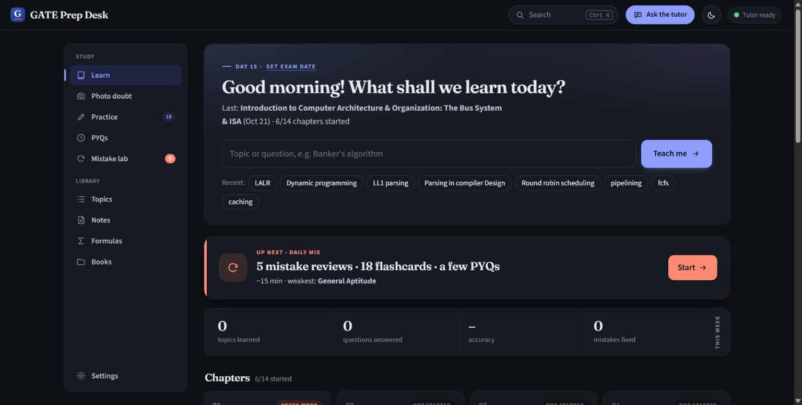
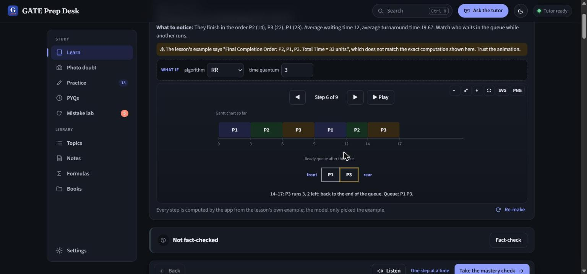
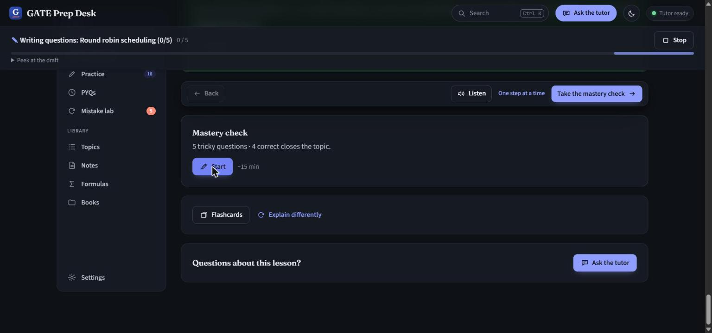
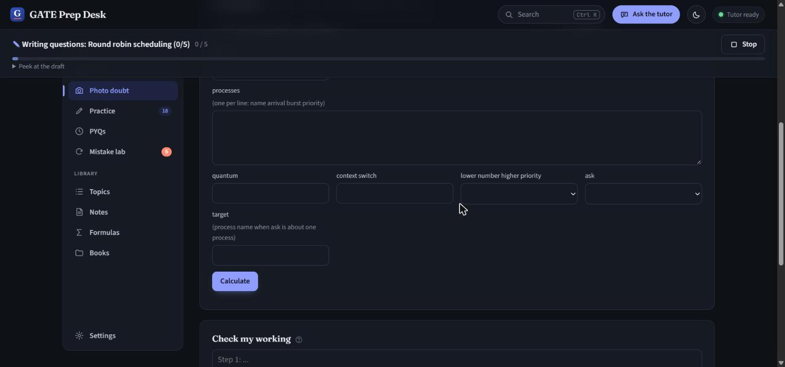
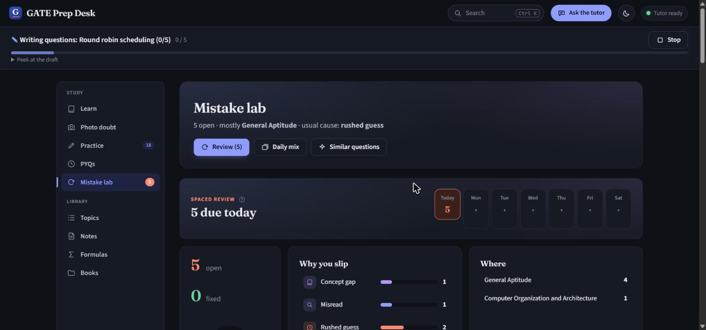
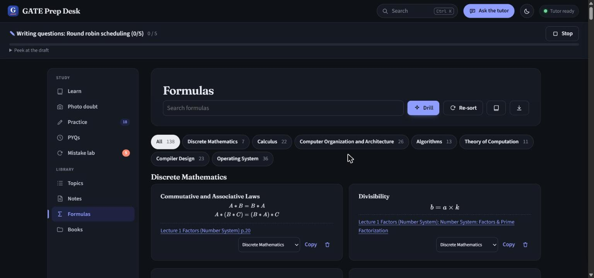

# 🎓 GATE Prep Desk
**A high-performance, local-first AI tutor for GATE Computer Science, engineered for privacy and precision.**

GATE Prep Desk is a sophisticated educational ecosystem that runs entirely on your local machine. It leverages state-of-the-art Small Language Models (SLMs) via Ollama to provide deep, step-by-step tutoring without requiring an internet connection or external API costs.

## 📸 Screenshots

| | |
|---|---|
| **Home**: ask any topic, daily mix, syllabus progress  | **Animated lesson**: steps computed by the app, not the model  |
| **Mastery check**: 5 tricky questions, 4 correct closes the topic  | **Exact calculators**: scheduling, paging, cache, subnetting, K-map, CRC  |
| **Mistake lab**: why you slip + spaced review  | **Formula library**: built from your own lessons  |

## 🚀 Key Features

### 🧠 Intelligent Learning Path
- **Structured Pedagogy**: Lessons follow a rigorous sequence: Big Picture $\rightarrow$ Prerequisites $\rightarrow$ Deep Dive $\rightarrow$ Mastery Check.
- **Mastery-Based Progression**: Topics are only marked as "Mastered" once you pass a "twisted" question set designed to test conceptual depth.
- **Personalized Context**: The tutor integrates your own notes and studied topics to tailor explanations to your current knowledge level.

### 🛠️ Engineering Precision
- **Exact Calculators**: Unlike standard LLMs that struggle with math, this system uses dedicated code-based solvers for:
  - CPU Scheduling, Paging, and Cache Mapping.
  - IPv4 Subnetting and TCP Congestion Control.
  - Banker's Algorithm and Disk Scheduling.
  - DFA/NFA Minimization and Graph Algorithms (Dijkstra, Prim, Kruskal).
- **C-Code Execution**: A built-in GCC compiler runs C programs in real-time to verify output, eliminating the "hallucinations" common in AI-generated code.
- **Formal Verifiers**: Built-in interpreters for Relational Algebra, Boolean expressions, and Regular Expressions.

### 👁️ Advanced Visuals & OCR
- **Dynamic Diagrams**: Generates interactive flowcharts, state diagrams, and Gantt charts with step-by-step animations.
- **Photo Doubt**: Integrated OCR and Vision models allow you to snap a photo of a question and receive a verified, step-by-step solution.
- **Visual Mnemonics**: (Optional) Generates AI-powered analogy images to help anchor complex concepts in memory.

### 📉 Performance & Privacy
- **100% Local**: Powered by `qwen3.5:4b` via Ollama. No data ever leaves your laptop.
- **Optimized for Hardware**: Specifically tuned for NVIDIA RTX GPUs with 8-bit KV caching for maximum speed and minimal VRAM usage.

## 🛠️ Tech Stack
- **LLM Engine**: Ollama (`qwen3.5:4b`)
- **Backend**: PowerShell / Node.js / GCC
- **Frontend**: Modern HTML5/CSS3/JS (Custom Visualization Engine)
- **OS**: Windows 11

## 🏁 Quick Start
1. **Install Ollama**: Download and install [Ollama](https://ollama.com/).
2. **Pull Model**: Run `ollama pull qwen3.5:4b`.
3. **Launch**: Double-click the `GATE Prep Desk` shortcut on your desktop or run `launcher.ps1`.

---
**Author:** Navaz Chilakala
